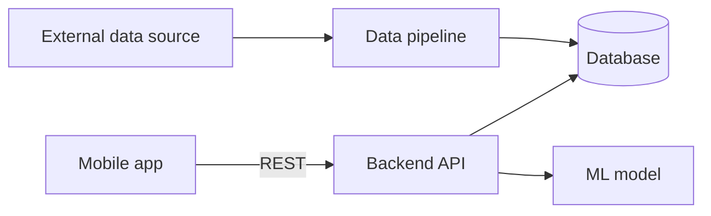

# Project Name

> One sentence: what this does and for whom.
> Example: *A mobile app that shows wildfire risk for any area in Egypt, using NASA satellite data and a machine-learning risk model.*

<!-- Replace the badge path with your org/repo -->


<!-- Add a screenshot or GIF of the working app here. It's the first thing a recruiter looks at. -->

## The problem

2–4 sentences. Who has this problem, and why existing options don't solve it.

## What it does

- Feature 1 — one line
- Feature 2 — one line
- Feature 3 — one line

## Architecture



Details and decisions: [docs/architecture.md](docs/architecture.md) · [ADRs](docs/adr/)

## Tech stack

| Layer | Technology | Why |
|---|---|---|
| Mobile / frontend | | |
| Backend | | |
| Database | | |
| ML | | |
| Deployment | | |

## Run it locally

**Prerequisites:** list exact tools and versions (e.g. Docker 24+, Flutter 3.x, Python 3.12, uv).

```bash
git clone https://github.com/ORG/REPO.git
cd REPO
cp .env.example .env        # then fill in the values
docker compose up --build   # the goal: one command starts everything
```

Then open … / run the app with …

## Run the tests

```bash
# one command per part, e.g.
cd backend && uv run pytest
cd mobile && flutter test
```

## Project structure

```
.
├── frontend/  # the app or website users see: start with its README
├── backend/   # API, database, demo data: start with its README
├── ai/        # AI part (delete if the project has none): start with its README
├── docs/      # team-wide guides: workflow, done, review, architecture, ADRs
└── .github/   # CI, templates, CODEOWNERS
```

## Team

| Name | GitHub | Main areas |
|---|---|---|
| | @ | |

Supervised by: … · Institute: …

## How we work

We work like a production team: every change is an issue on the board, a short-lived branch, and a reviewed pull request. Read [CONTRIBUTING.md](CONTRIBUTING.md) before your first PR.

## License

Choose one before the repo goes public (MIT is a common default for student projects).
