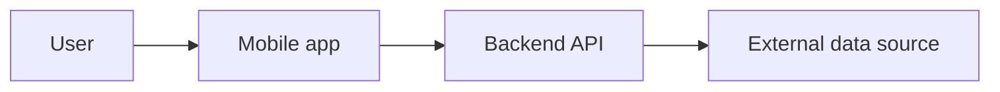
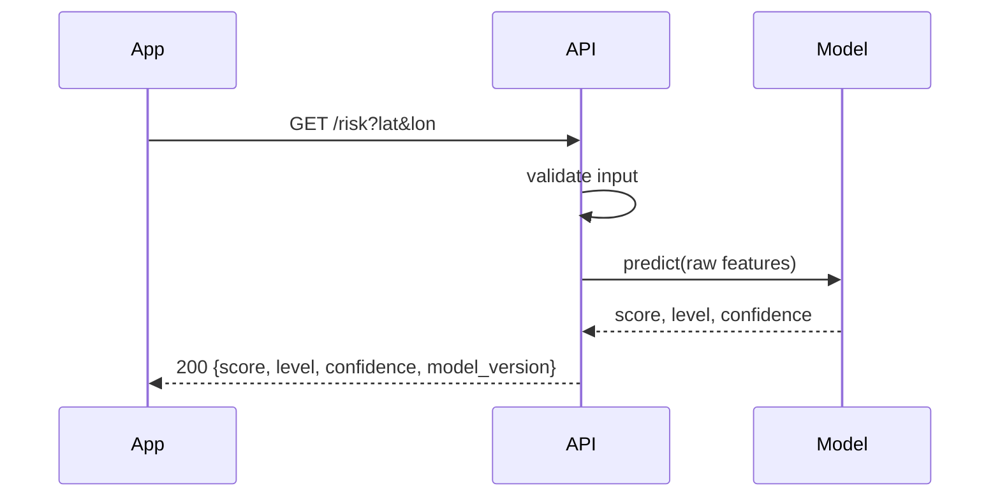

# Architecture

> Living document. Update it in the same PR that changes the architecture. First version is due at milestone M1; keep it to 1–2 pages.

## 1. Context

What the system does, who uses it, and which external systems it talks to.

## 2. Components

| Component | Responsibility | Tech | Owner |
|---|---|---|---|
| Mobile app | | | @ |
| Backend API | | | @ |
| Data pipeline | | | @ |
| ML model | | | @ |
| Database | | | @ |

## 3. Main flows

Describe the 2–3 most important flows step by step (or as a sequence diagram).

## 4. API contract

Agree on the contract **before** building both sides, so mobile and backend can work in parallel (mobile uses a mock until the endpoint is ready).

| Method | Path | Request | Response | Errors |
|---|---|---|---|---|
| GET | `/health` | — | `{status, version}` | — |
| | | | | |

For REST backends, the generated OpenAPI docs (e.g. FastAPI's `/docs`) become the detailed contract once built.

## 5. Data

| Data | Source | Update frequency | Stored where | Size |
|---|---|---|---|---|
| | | | | |

Each external dataset gets a short data card in `docs/data/<name>.md`: fields used, license/terms, limits (rate limits, resolution, gaps).

## 6. Configuration & deployment

- All settings: `.env.example`
- Local: `docker compose up`
- Demo/production deployment: where and how

## 7. Decisions

Significant decisions are recorded as ADRs in [adr/](adr/). List them here:

- [ADR-0001](adr/0001-record-architecture-decisions.md) — Record architecture decisions
